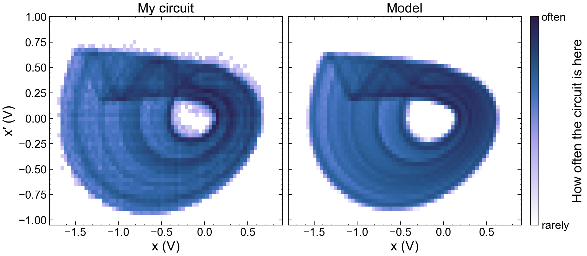
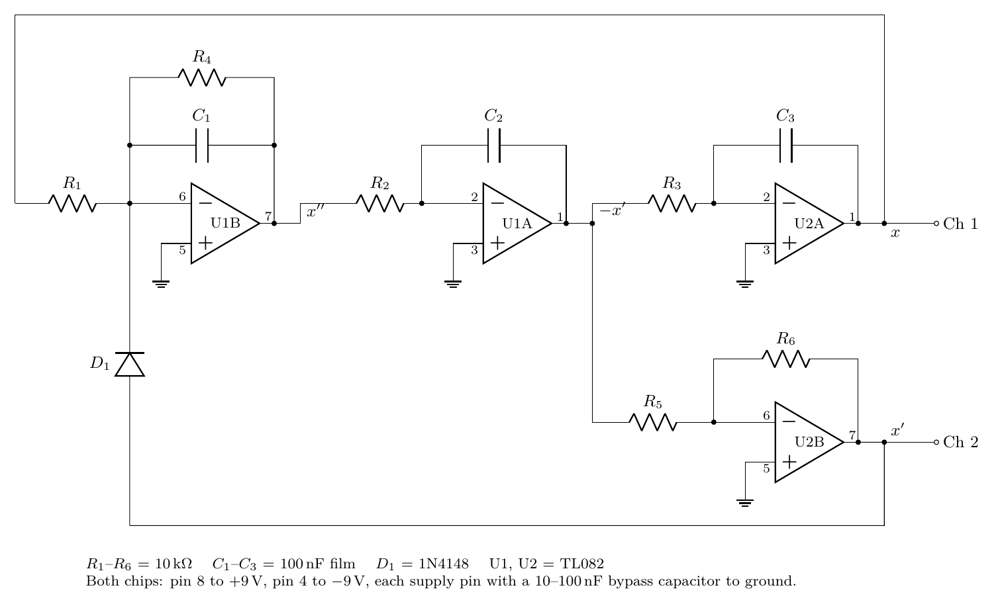
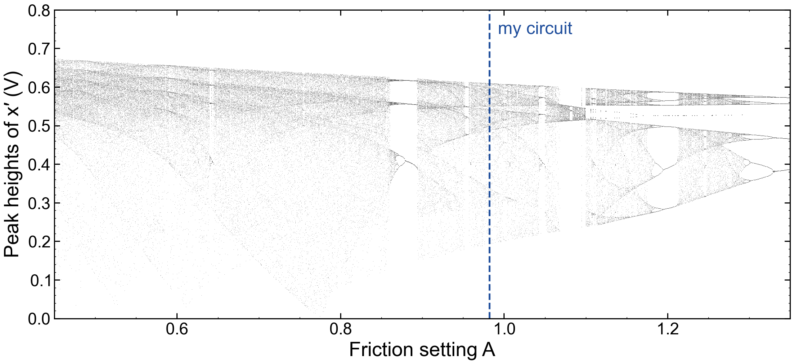
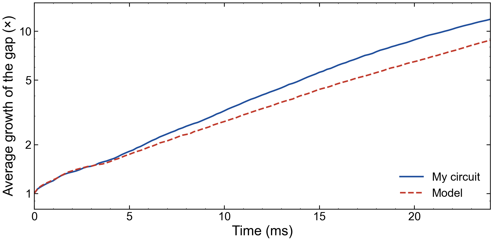
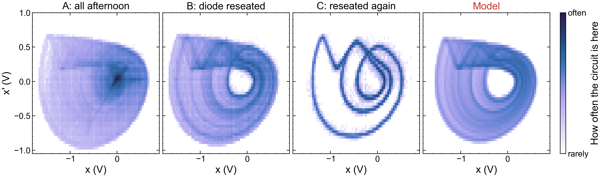

# Chaos on a breadboard: Sprott's diode jerk circuit

Measurements of the diode jerk circuit from Sprott (2011), built on a breadboard and recorded with a USB
oscilloscope, compared with a model that has nothing fitted. Data, analysis code, figures and a write-up.

I TA an electronics lab course and wanted a chaotic circuit that students could build and measure. I'd built a
Chua circuit first. It worked, but a touch, a loose contact or a 1X probe could kill the double scroll. Sprott's
circuit has one diode and no trimmer, so I built that instead, and with the diode freshly seated it matched the
model to about 3 %. What surprised me was that the same board, with the same parts, showed three different states
on the same day, and each change came right after I'd pulled the diode out and put it back.


*Where the circuit spends its time in the (x, x′) plane: my board (left) and the model (right), with no
parameters fitted. Darker means more time.*

- **[Build it yourself](docs/build.md):** schematic, parts, a check after each stage, what you should see on the
  scope, and what to do when it doesn't work.
- **[Results in detail](docs/results.md):** everything I measured and what it means
  (also as a [PDF](writeup/sprott_writeup.pdf), 13 pages).
- **Talk for a general audience:** [`talk/Chaos_on_a_breadboard.pdf`](talk/Chaos_on_a_breadboard.pdf).

## The circuit

$$\dddot{x} = -A\ddot{x} - x - R I_s\left(e^{\dot{x}/nV_T} - 1\right)$$

Three op-amp integrators in a loop, an inverter and one diode (two TL082s, ±9 V, R ≈ 10 kΩ, C ≈ 100 nF).
Time runs in units of $\tau = (R_1C_1\,R_2C_2\,R_3C_3)^{1/3} \approx 1$ ms, and A = τ/(R4·C1) sets the damping.
The diode is the only nonlinear part. With the measured parts, A = 0.982 and τ = 1.006 ms.



The [build guide](docs/build.md) takes it from parts to chaos on the scope. The hole-by-hole build sheet
([`hardware/sprott_build.pdf`](hardware/sprott_build.pdf)) is drawn by a script that checks the wiring against
the schematic netlist first.

## What I found

All from 19 November 2026: 13 runs, 1,640 captures of 100 ms on a Tektronix TBS 1052B-EDU, none clipped.
The model uses the measured R and C and the SPICE 1N4148 diode parameters.

- **The board matches the model.** With the diode freshly seated, it agrees with the model to about 3 % in
  size and frequency, with the same attractor shape and the same single-humped return map.
- **It is chaotic.** Largest Lyapunov exponent 0.122 per τ (121 s⁻¹, Lyapunov time 8.3 ms), against 0.0986 per τ
  for the model. Correlation dimension 2.01 ± 0.03 (model 2.08 ± 0.02): a thin fractal sheet just above two
  dimensions.
- **The diode sets the size.** A germanium diode shrinks the whole attractor to a third and it stays chaotic,
  as the equation says it should: the diode's turn-on voltage is the circuit's only voltage scale.
- **Still open.** The board is 20–26 % more chaotic than the model, and with the same parts it also showed two
  other states (below). Since 23 November it has stayed in one of them, a periodic orbit.


*Peaks of x′ in the model as the damping A changes (A is called "friction" in the talk figures). Lowering A
takes the circuit through period doubling into chaos, with narrow periodic windows inside the chaotic band.
My board sits at A = 0.982.*


*Two states that start close drift apart exponentially. Average growth of the gap between neighbouring states,
board and model, through the same code. The board's gap grows faster.*

## The puzzle: three states with the same parts


*The same board on the same day. A: all afternoon, chaotic but lingering near the origin 40 % of the time.
B: after I reseated the diode, matching the model. C: after reseating it again, a periodic orbit.*

Two things fit state C, and the data so far can't tell them apart: about 75 Ω of contact in series with the
diode, or R4 moved up by about 3 %, to 10.31–10.34 kΩ. Both give the model the same period-4 orbit. Since
23 November the board has come up in C every time, through five power cycles and new diodes, so it isn't picking
between states at power-up: something physical changed and stayed changed. A DVM check of R4 in place and of the
diode's contacts will settle it.

State A doesn't fit any setting of the model or any contact resistance. In state A the measured x jumps between
two levels about 60 times a second, in step with the circuit's motion, but adding those jumps to the model
doesn't reproduce A either. The next bench tests are in [the results](docs/results.md#open-questions-and-next-steps).

## What's in the repo

| path | what it is |
|---|---|
| `docs/` | the [build guide](docs/build.md) and the [results](docs/results.md) |
| `data/` | all 13 runs (HDF5, 63 MB) and capture logs; [`data/README.md`](data/README.md) lists the runs and the file format |
| `sprott_scope.py` | records the circuit from the scope over USB (`--fake` simulates captures, no scope needed) |
| `sprott_scope_analysis.py` | quick-look figure for one run |
| `analysis/` | one script per figure; `sprott_common.py` holds the model and shared code; numbers in `results/*.json` |
| `figures/` | every figure as PDF, plus PNGs for the pages here |
| `hardware/` | schematic, breadboard build sheet, and a coupling board for syncing two circuits (drawn, not built) |
| `design/` | simulations from before the build |
| `writeup/` | `build.sh`, which checks the pages and builds the PDF from `docs/results.md` |
| `talk/` | slides for a general audience |

## Running it

```bash
python3 -m pip install -r requirements.txt   # pyvisa, pyvisa-py and pyusb are only needed for the scope
```

Remake the figures on these pages, the result files, the drawings and the PDF (side studies such as
`fig_jump_model.py` and `fig_diode_inferred.py` run on their own):

```bash
analysis/run_all.sh
```

Simulations are cached in `analysis/cache/` (not in the repo), so the first run takes longer than later ones.
The PDF and the schematic need pandoc, XeLaTeX (with circuitikz) and pdftoppm. The PDF uses the macOS fonts
Palatino and Menlo; elsewhere, set `mainfont` and `monofont` in `writeup/pdf_meta.yaml` to fonts you have.
After editing a page, run `writeup/build.sh`: it checks the pages for broken links and leftover markup before building the PDF.

Record a run (scope on USB, Ch1 on x, Ch2 on x′), or try the pipeline without a scope:

```bash
python3 sprott_scope.py capture --n 100 --r4 10030 --label myrun
python3 sprott_scope.py capture --n 20 --fake
python3 sprott_scope_analysis.py data/sprott_myrun_*.h5
```

## License

Code is under the MIT license ([`LICENSE`](LICENSE)). Text, figures, drawings and data are under CC BY 4.0
([`LICENSE-docs`](LICENSE-docs)).

## References

- J. C. Sprott, "A New Chaotic Jerk Circuit," *IEEE Trans. Circuits Syst. II* **58**, 240–243 (2011).
  [doi:10.1109/TCSII.2011.2124490](https://doi.org/10.1109/TCSII.2011.2124490)
- M. T. Rosenstein, J. J. Collins, C. J. De Luca, "A practical method for calculating largest Lyapunov exponents
  from small data sets," *Physica D* **65**, 117–134 (1993).
  [doi:10.1016/0167-2789(93)90009-P](https://doi.org/10.1016/0167-2789(93)90009-P)
- G. Benettin, L. Galgani, A. Giorgilli, J.-M. Strelcyn, "Lyapunov characteristic exponents for smooth dynamical
  systems and for Hamiltonian systems; a method for computing all of them. Part 1: Theory," *Meccanica* **15**,
  9–20 (1980). [doi:10.1007/BF02128236](https://doi.org/10.1007/BF02128236)
- P. Grassberger, I. Procaccia, "Characterization of Strange Attractors," *Phys. Rev. Lett.* **50**, 346–349
  (1983). [doi:10.1103/PhysRevLett.50.346](https://doi.org/10.1103/PhysRevLett.50.346)
- J. L. Kaplan, J. A. Yorke, "Chaotic behavior of multidimensional difference equations," in *Functional
  Differential Equations and Approximation of Fixed Points*, Lecture Notes in Mathematics, pp. 204–227
  (Springer, 1979). [doi:10.1007/BFb0064319](https://doi.org/10.1007/BFb0064319)
