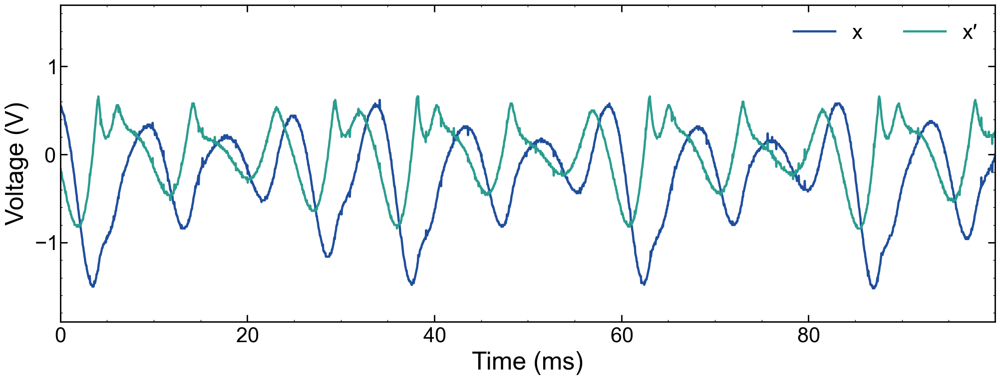
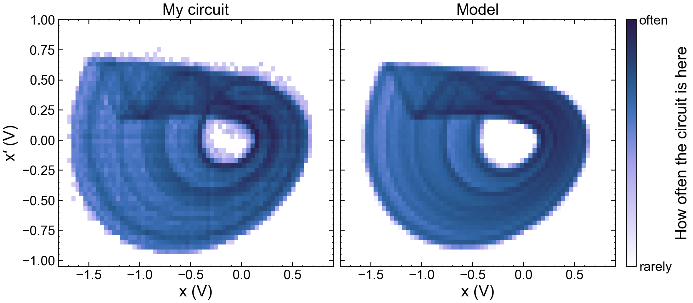
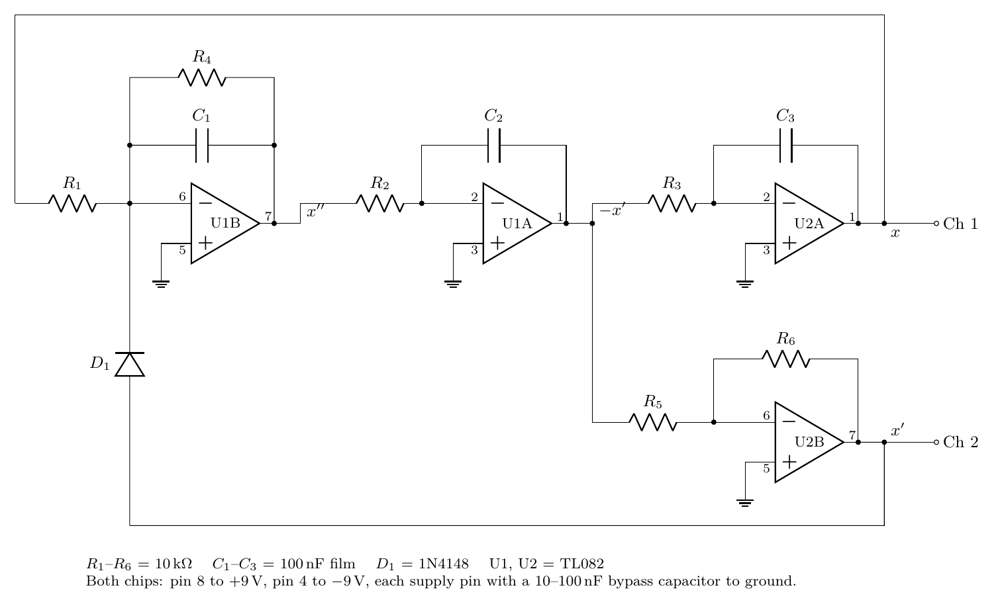
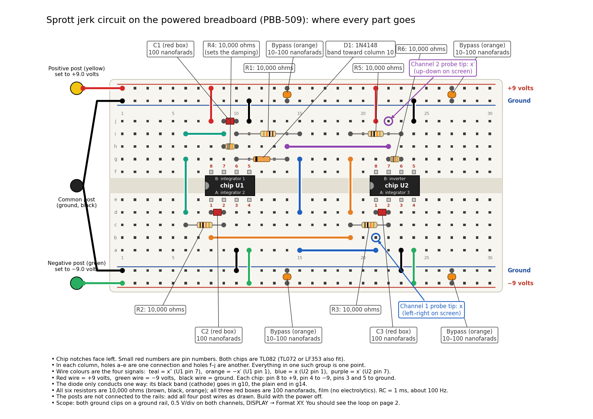

# Building Sprott's diode jerk circuit

This is how to build the circuit I measured, on a breadboard, and get chaos on a scope. It assumes you have done
an electronics lab course: you can read an op-amp schematic and use a breadboard, a DVM and a two-channel scope.
The circuit is from Sprott's 2011 paper (J. C. Sprott, *IEEE Trans. Circuits Syst. II* **58**, 240 (2011),
[doi:10.1109/TCSII.2011.2124490](https://doi.org/10.1109/TCSII.2011.2124490)). What my board did is in
[results.md](results.md).

## What you'll see when it works

Two signals that look almost periodic but never repeat, at about 110 Hz. Each loop has a slightly different
height, and which height comes next depends so strongly on the last one that you can't predict more than a few
loops ahead. In XY mode the scope draws a band of loops around a hole, with a fold at the top left.



*Figure 1.* x (Ch1) and x′ (Ch2) on my board, one capture of 100 ms at 0.5 V/div and 10 ms/div, straight from the
scope (run B).



*Figure 2.* The XY picture: where the circuit spends its time in the (x, x′) plane, on my board (left) and in the
model (right), from many captures. Darker means more time. On the scope you'll see the same shape traced out as
a moving line.

## The circuit



*Figure 3.* The circuit as I built it. Pin numbers are for the TL082. Ch1 and Ch2 are the scope probes.

Three inverting integrators in a loop make x″, −x′ and x (U1B, U1A, U2A). Each has R ≈ 10 kΩ and C ≈ 100 nF, so
its time constant RC is about 1 ms. That sets the speed of everything: the circuit loops at about 100 Hz
(110 Hz on my board). An inverter (U2B) turns −x′ into x′, which drives the diode D1. The diode's current flows
into the first integrator's summing node, together with x through R1 and x″ through R4.

Put together, the circuit solves

$$\dddot{x} = -A\,\ddot{x} - x - R\,I_D(\dot{x}),$$

with time in units of RC and $I_D$ the diode current. A = R/R4 is the damping. The diode is the only nonlinear
part: it does nothing until x′ reaches its turn-on voltage, about 0.6 V, and then pushes the orbit back towards
the origin. Without it the origin is unstable and the signal would grow until the op-amps hit the rails.

## Parts and tools

| part | value | notes |
|---|---|---|
| U1, U2 | TL082 dual op-amp | TL072 or LF353 also work (same pinout) |
| R1, R2, R3, R5, R6 | 10 kΩ (brown, black, orange) | R5 and R6 should match: the inverter's gain is R6/R5 |
| R4 | 10 kΩ | sets the damping A = R/R4; see the table at the end |
| C1, C2, C3 | 100 nF (104) film, non-polar | not electrolytic |
| D1 | 1N4148 | 1N914 is the same; a 1N4004 works but gives a slightly smaller attractor |
| bypass capacitors | 4 × 10–100 nF ceramic | across the rails, next to the chips |
| supply | ±9 V | I used a PBB-509 powered breadboard; any ±9 V bench supply works |
| tools | DVM, two-channel scope, jumper wires | a USB scope connection if you want to record |

## Measure the parts first

Measure every R and C on the DVM before you put it in, and write the values down. Two numbers decide what the
circuit does: the time unit τ and the damping A. With unequal parts they are

$$\tau = (R_1C_1\,R_2C_2\,R_3C_3)^{1/3}, \qquad A = \frac{\tau}{R_4 C_1}.$$

```python
R1, R2, R3, R4 = 9850, 9950, 9850, 10030    # ohms (mine; put in yours)
C1, C2, C3 = 102.1e-9, 99.4e-9, 103.9e-9    # farads
tau = (R1 * C1 * R2 * C2 * R3 * C3) ** (1 / 3)
A = tau / (R4 * C1)
print(f"tau = {tau * 1e3:.3f} ms, A = {A:.3f}")   # mine: tau = 1.006 ms, A = 0.982
```

Why bother: the circuit is chaotic for most values of A near 1, but there are narrow ranges where it settles on a
repeating loop instead (one of them is only 0.3 % wide, just below my A). If you know your A you can tell whether
a periodic picture means a wiring fault or just a periodic window. The table at the end says what to expect.

## Build it in stages

The hole-by-hole layout is in [`hardware/sprott_build.pdf`](../hardware/sprott_build.pdf) (page 1 below; page 2
has the parts list and the same steps). Hole names like b21 refer to it. The script that draws it checks every
connection against the schematic's netlist first, so if you follow it exactly the wiring is right. You can also
use your own layout and the schematic.



*Figure 4.* Page 1 of the build sheet: where every part and wire goes on the PBB-509.

### Stage 1: power and chips

Power off. Set the supply to ±9 V and check it on the DVM: +9 V and −9 V against ground. Put both chips in
(notch to the left), then the power wires and the four bypass capacitors. Power on.

**Done looks like:** pin 8 of each chip at +9 V, pin 4 at −9 V, both against ground, and the chips stay cool to
the touch. Don't check the outputs yet: with nothing on the inputs they sit near a rail, and that's normal.

**If not:** a chip that gets warm within seconds is usually in backwards or has its supply pins swapped. Power off
at once and check the notch and the rail wires.

### Stage 2: everything else, checked with the power off

Power off. Put in the resistors, the capacitors, the diode (band towards U1 pin 6) and the signal wires. Before
you power on, check these on the DVM, still with the power off:

| between | what's there | expect |
|---|---|---|
| U1 pin 6 and U1 pin 7 | R4 (with C1) | your R4, about 10 kΩ, after a moment while C1 charges |
| U2 pin 6 and U2 pin 7 | R6 | about 10 kΩ |
| U2 pin 1 and U1 pin 6 | R1 | about 10 kΩ |
| U1 pin 7 and U1 pin 2 | R2 | about 10 kΩ |
| U1 pin 1 and U2 pin 2 | R3 | about 10 kΩ |
| U1 pin 1 and U2 pin 6 | R5 | about 10 kΩ |
| red on U1 pin 2, black on U1 pin 1 | C2 | climbs and never settles (open) |
| red on U2 pin 1, black on U2 pin 2 | C3 | climbs and never settles (open) |
| U2 pin 7 (red) to U1 pin 6 (black), diode test | D1 forward | about 0.55–0.7 V |
| the same, leads swapped | D1 reversed | open (OL) |

Keep the leads the way round given for C2 and C3. Reversed, the meter finds a path through the other resistors
and D1 and settles at some higher reading, which is also fine. For the diode, the SPICE 1N4148 model gives
0.55–0.58 V at 0.5–1 mA; real parts read a little higher (my board's diode needed about 23 mV more than the
model), and your meter's test current sets the exact number.

**Done looks like:** every line in the table as expected, and nothing near 0 Ω.

**If not:** near 0 Ω where you expect 10 kΩ or open is a short, often two bare leads touching where several
parts meet. A reading far above 10 kΩ is a part in the wrong row or a lead not making contact. A diode that
reads open both ways is in the wrong holes; one that reads 0.6 V the wrong way round is reversed.

### Stage 3: first power-up

Probes 1X, DC coupled, both at 0.5 V/div, 10 ms/div. Ch1 on x (U2 pin 1, hole b21), Ch2 on x′ (U2 pin 7,
hole j22), ground clips on the ground rail. Power on.

**Done looks like:** the oscillation starts by itself within a second; you don't need to kick it, because the
origin is unstable. Then, from my board (run B) and the model at my parts (0.1–99.9 % of the time):

| | my board | model | where |
|---|---|---|---|
| x | −1.64 to +0.64 V | −1.52 to +0.59 V | Ch1, U2 pin 1 |
| x′ | −0.90 to +0.64 V | −0.86 to +0.60 V | Ch2, U2 pin 7 |
| x″ | not recorded | −0.95 to +1.16 V | U1 pin 7, if you probe it |
| main frequency of x | 110 Hz | 107 Hz | |

The tops of x′ stop near 0.6 V because that's where the diode turns on. Switch to XY mode (Ch1 on the horizontal
axis): you should see Figure 2's shape traced over and over, never quite the same loop twice. My board was about
3 % larger than the model.

**If not:** see [When it doesn't work](#when-it-doesnt-work).

## Recording it

[`sprott_scope.py`](../sprott_scope.py) records the scope over USB with PyVISA. I used a Tektronix
TBS 1052B-EDU; it also works with other Tektronix scopes that use the same commands (it says so and stops if
yours doesn't). Plug the scope's rear USB port into the laptop, then:

```bash
python3 -m pip install -r requirements.txt
python3 sprott_scope.py list                                     # finds the scope and prints its ID
python3 sprott_scope.py capture --n 100 --r 9883 --c 101.8e-9 --r4 10030 --label myrun
python3 sprott_scope_analysis.py data/sprott_myrun_*.h5          # quick-look figure of the run
```

Put in your own measured R (I used the mean of R1–R3), C (mean of C1–C3) and R4. Each capture is one single-shot
acquisition of both channels, 2,500 points each, and takes about 2.75 s, so 100 captures take under 5 minutes.
The file format is in [`data/README.md`](../data/README.md). No scope? `--fake` simulates the captures, so you can
try the whole pipeline first:

```bash
python3 sprott_scope.py capture --n 20 --fake
```

## When it doesn't work

| what you see | likely cause | what to try |
|---|---|---|
| a flat line, or the trace gone off the screen at 0.5 V/div | an output stuck at a rail | switch to 2 V/div to see it; check the integrator capacitors and R4 are in the right holes; redo the stage 2 table |
| nothing at all | no power to the chips, or probes on the wrong holes | redo stage 1; probe U2 pin 1 and pin 7 directly |
| one clean loop, or a few loops that repeat exactly | a periodic window | check your A against the table below; change R4 by a few percent |
| a periodic loop that appeared after you moved a part | R4 or a contact changed | measure R4 in place (U1 pin 6 to 7) and the diode's contacts; this happened to me ([results](results.md#three-states-with-the-same-parts)) |
| chaotic, but about a third the size | a germanium diode in D1 | that's real: the size scales with the diode's turn-on voltage |
| chaotic, but spends a lot of time near the origin and runs slow (about 90 Hz) | my "state A", not yet explained | see [results](results.md#three-states-with-the-same-parts); reseat D1 with the power off |
| fuzzy traces | noise | about 13 mV rms on top of the scope's 20 mV steps was normal on my board; keep probe grounds short |

What the model does at standard values of R4, with my τ and C1 (A = τ/(R4·C1)). Use your own A to compare, since
it's A that matters, not R4:

| R4 | A | model |
|---|---|---|
| 20 kΩ | 0.493 | chaos |
| 15 kΩ | 0.657 | chaos |
| 12 kΩ | 0.821 | chaos or period 6–7, depending on the start |
| 11 kΩ | 0.896 | chaos |
| 10.03 kΩ (mine) | 0.982 | chaos |
| 9.1 kΩ | 1.083 | periodic (period 1, 3, 4 or 5) |
| 8.2 kΩ | 1.202 | periodic (period 1 or 6) |
| 7.5 kΩ | 1.314 | periodic (period 8) |

Just above my R4 there is a narrow periodic window at R4 = 10.31–10.34 kΩ (A = 0.953–0.956), periods 4–6. The
bifurcation diagram in [results.md](results.md#state-b-the-models-attractor-and-it-is-chaotic) (Figure 2a there)
shows all of them.

## Going further

- **Your own bifurcation diagram.** Replace R4 with a 10-turn trimmer and step through A. The model's predictions are in the table above and in open question 4 of
  [results.md](results.md#open-questions-and-next-steps).
- **Swap the diode.** A germanium diode shrinks the attractor to about a third and it stays chaotic, which is a
  nice check that the diode sets the only voltage scale.
- **Two circuits in sync.** A one-way coupling board is drawn in
  [`hardware/sprott_coupling_addon.pdf`](../hardware/sprott_coupling_addon.pdf) but I haven't built it.
