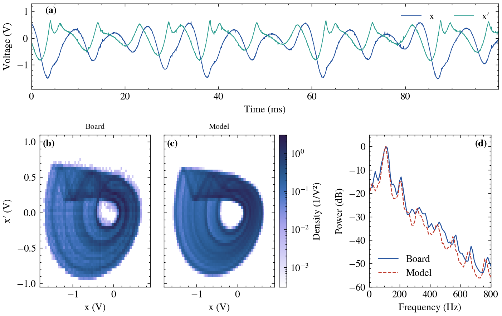
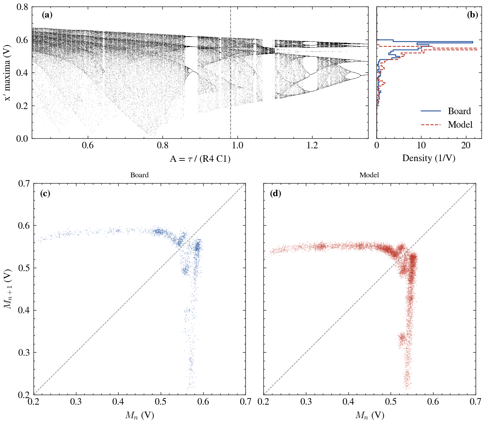
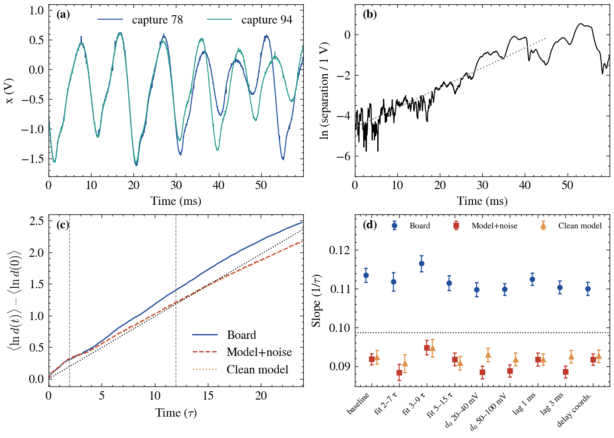
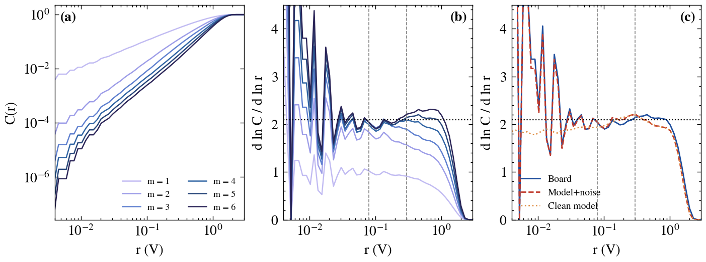
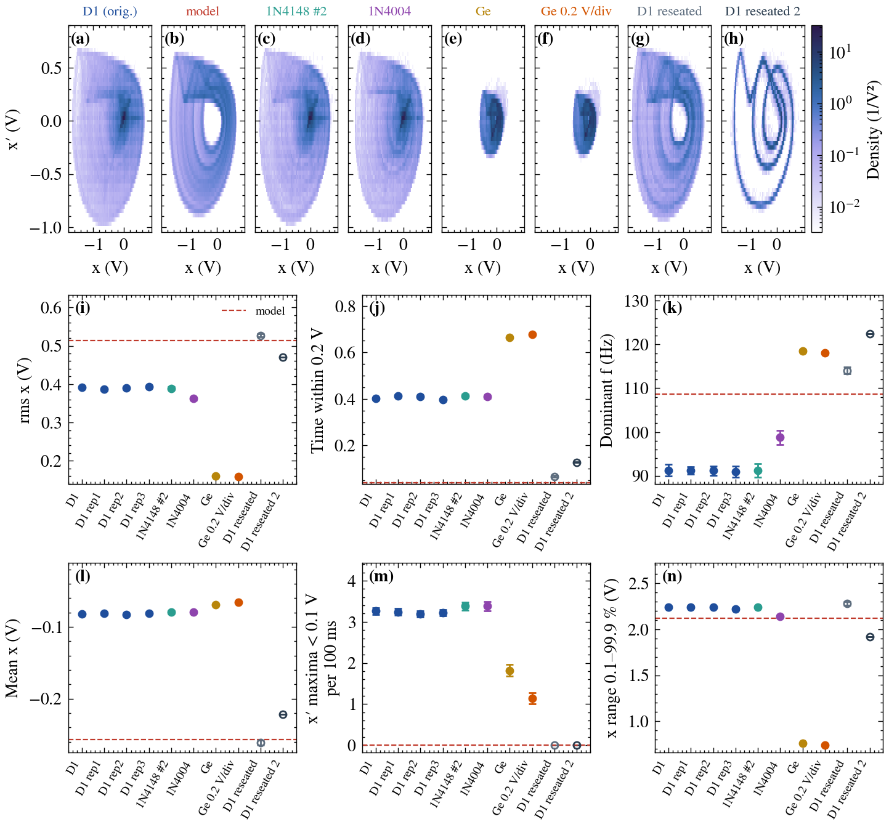
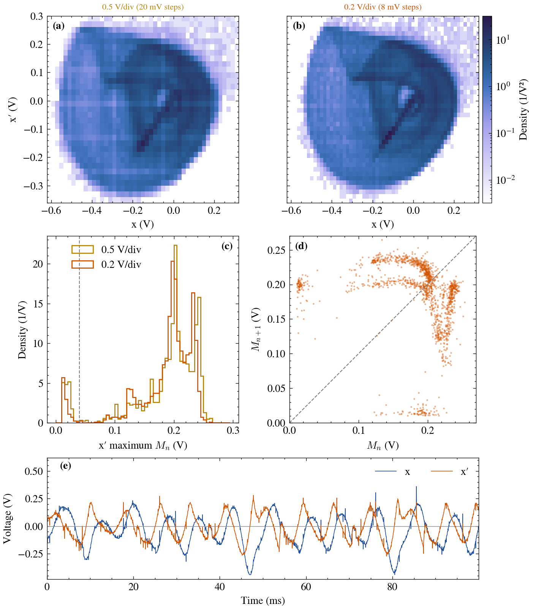
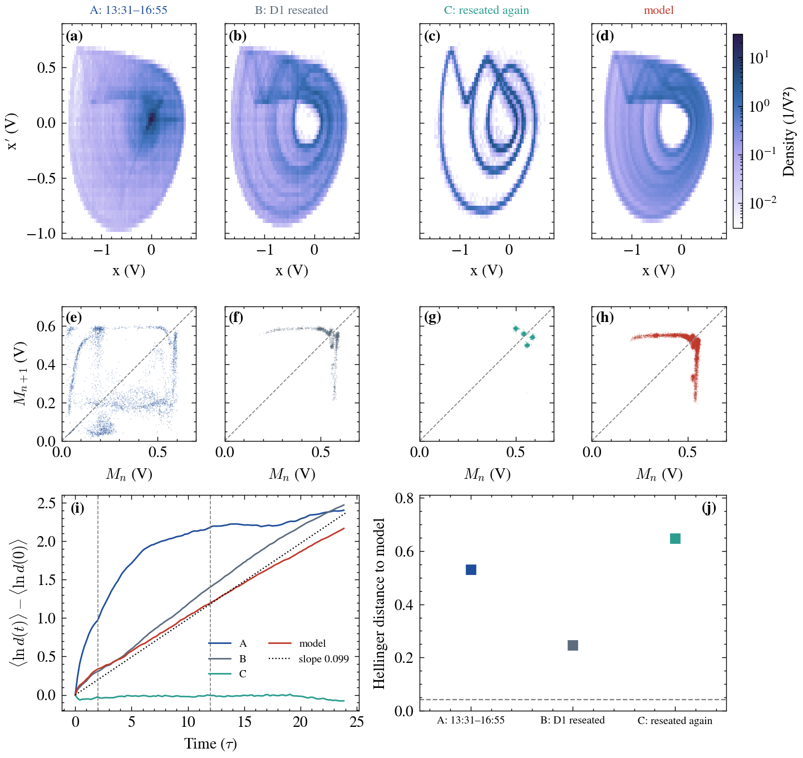
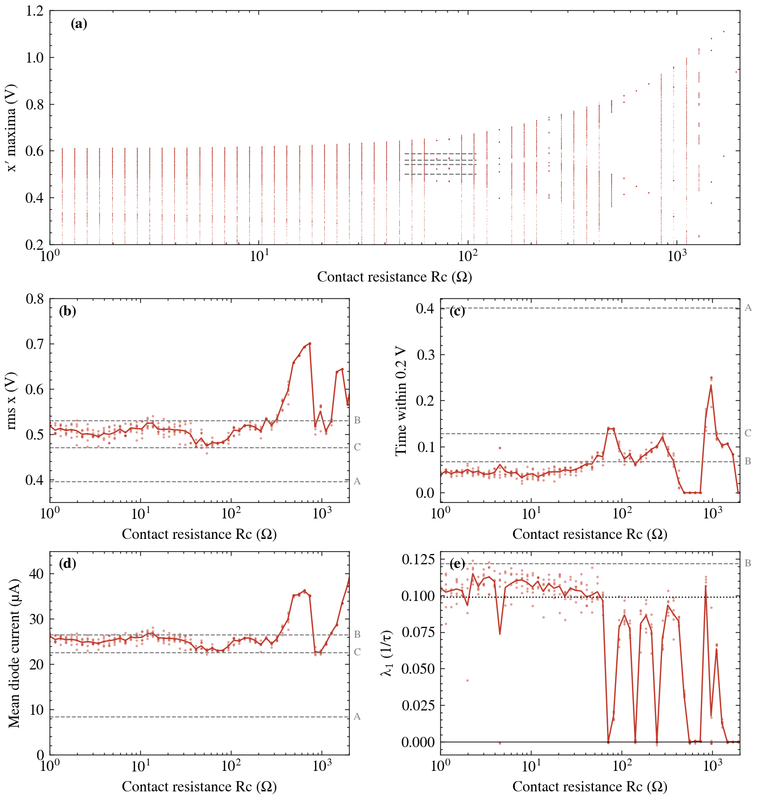
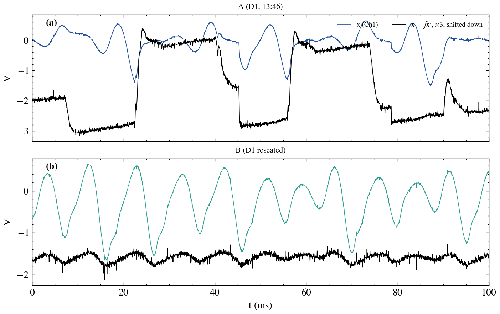

# Chaos on a breadboard: measurements of Sprott's diode jerk circuit

## Summary

I built the diode jerk circuit from Sprott's 2011 paper [1] on a breadboard and recorded it with a Tektronix
TBS 1052B-EDU over USB: 13 runs on 19 November 2026, 1,640 captures of 100 ms (some of 250 ms), none clipped. I
measured every part on a DVM and compared the board with a model that uses those values and the SPICE parameters
of the 1N4148 diode. Nothing in the model is fitted.

- With the diode freshly reseated (state B), the board matches the model to about 3 % in size and frequency, with
  the same attractor shape and the same single-humped return map.
- It is chaotic. Its largest Lyapunov exponent is 0.122 per τ (121 s⁻¹, Lyapunov time 8.3 ms), 20–26 % above
  the model's 0.0986 per τ. Its correlation dimension is 2.01 ± 0.03 (model 2.08 ± 0.02).
- The diode sets the size of the attractor. A germanium diode shrinks it to a third, and it stays chaotic.
- With the same parts the board also showed a chaotic state that lingers near the origin (state A) and a periodic
  orbit (state C). Since 23 November it has stayed in state C, through five power cycles and new diodes. Two
  things fit C: about 75 Ω in series with the diode, or R4 moved up to about 10.3 kΩ. State A is not explained
  yet.

## The circuit and the model

Sprott's circuit solves

$$\dddot{x} = -A\,\ddot{x} - x - R I_s \left(e^{\dot{x}/nV_T} - 1\right),$$

with time in units of $\tau = (R_1C_1\,R_2C_2\,R_3C_3)^{1/3}$ and x in volts. Three op-amp integrators in a loop
make x, ẋ and ẍ. An inverter feeds ẋ to the diode D1, whose current flows back into the first integrator.
A = τ/(R4·C1) sets the damping. The diode is the only nonlinear part of the circuit and its only voltage scale.

I built it on a PBB-509 powered breadboard with two TL082 dual op-amps, ±9 V, R ≈ 10 kΩ and C ≈ 100 nF, so
τ ≈ 1 ms and the circuit loops at about 100 Hz. The schematic, parts and build steps are in the
[build guide](build.md). The hole-by-hole layout is in [`hardware/sprott_build.pdf`](../hardware/sprott_build.pdf);
the script that draws it checks the wiring against the schematic netlist before it draws anything. Before
building, I checked in simulation that the 1N4148 version stays chaotic at these values
([`design/`](../design/)).

Measured parts: R1–R6 = 9.85, 9.95, 9.85, 10.03, 9.86, 9.93 kΩ; C1–C3 = 102.1, 99.4, 103.9 nF. That gives
τ = 1.006 ms and A = 0.982. The model uses these with the SPICE 1N4148 values ($I_s$ = 2.52 nA, n = 1.752,
$V_T$ = 25.85 mV) and R = 9.88 kΩ, the mean of R1–R3.

Near the origin the diode is off and the circuit is linear. The roots at A = 0.982 are −1.455 and
0.236 ± 0.795i per τ: the origin is an unstable spiral that grows by a factor 6.5 per turn. The diode is what
throws the orbit back towards it.

## Measurement

Ch1 is on x and Ch2 on ẋ (the inverter output, which also drives the diode). Both probes are 1X, DC coupled, at
0.5 V/div (20 mV per 8-bit step) and 10 ms/div, which gives 2,500 points per channel at 40 µs.
[`sprott_scope.py`](../sprott_scope.py) drives the scope with PyVISA and takes one single-shot capture every
2.75 s. That is about 300 loops between captures, so each capture is an independent piece of the attractor.
Errors below are bootstrap over captures.

The traces carry about 13 mV rms of fast noise on top of the 8-bit steps. It barely changes between 0.5 and
0.2 V/div, so it is on the signal (the circuit or pickup), not from the scope's input stage.

To compare like with like, the model's output goes through the same analysis code as the data, with the measured
noise and 8-bit rounding added ("model + noise"), or without them ("clean model").

*Table 1.* Every run except the 20-capture pipeline test and the 20-capture noise check. "State" is the board
behaviour described below; Ge marks the germanium runs, whose smaller attractor doesn't fit the A/B/C labels.
Peak frequency is from the averaged spectrum of x. The model row is the 1N4148 model with the measured noise and
8-bit steps.

<!-- RUN_TABLE -->

| time | D1 / change | n | state | rms x (V) | rms x′ (V) | peak f (Hz) | time within 0.2 V | mean x (V) | mean x′ (mV) |
|-----|--------------------|----|-----|-------|-------|-----------|--------|-------|-------|
| 13:46 | original D1 | 200 | A | 0.394 | 0.263 | 90.1 ± 0.3 | 0.401 | -0.082 | +12.1 |
| 14:02 | original D1 | 200 | A | 0.388 | 0.259 | 90.8 ± 0.3 | 0.414 | -0.081 | +13.1 |
| 14:11 | original D1 | 200 | A | 0.392 | 0.260 | 90.2 ± 0.3 | 0.411 | -0.083 | +12.3 |
| 14:21 | original D1 | 200 | A | 0.395 | 0.261 | 90.3 ± 0.3 | 0.398 | -0.081 | +12.6 |
| 14:30 | original D1, 25 ms/div | 200 | A | 0.389 | 0.259 | 91.5 ± 0.1 | 0.412 | -0.080 | +12.7 |
| 16:47 | second 1N4148 | 100 | A | 0.391 | 0.260 | 90.4 ± 0.4 | 0.413 | -0.079 | +11.6 |
| 16:55 | 1N4004 | 100 | A | 0.365 | 0.253 | 92.5 ± 3.1 | 0.409 | -0.079 | +9.7 |
| 17:11 | germanium | 100 | Ge | 0.160 | 0.128 | 118.4 ± 0.3 | 0.665 | -0.069 | -0.3 |
| 17:20 | germanium, 0.2 V/div | 100 | Ge | 0.158 | 0.126 | 118.0 ± 0.3 | 0.678 | -0.065 | -3.2 |
| 18:10 | D1 reseated | 100 | B | 0.530 | 0.370 | 110.4 ± 1.2 | 0.067 | -0.261 | +6.9 |
| 18:33 | D1 reseated again | 100 | C | 0.470 | 0.351 | 122.4 ± 0.0 | 0.128 | -0.222 | +8.1 |
| | model, A = 0.982 | 400 | | 0.516 | 0.368 | 107.2 | 0.040 | -0.257 | 0 |

<!-- /RUN_TABLE -->

## State B: the model's attractor, and it is chaotic

Run B (18:10) was taken after the diode swaps, with the original 1N4148 put back in D1. It is the run that
matches the model, so I used it for the chaos analysis.

*Table 2.* Run B against the model. The board's $\lambda_1$ is the divergence estimator's value corrected for the
estimator's bias on the model; mean and range over nine estimator settings. The board's Kaplan–Yorke dimension uses
that $\lambda_1$ with $\lambda_2 = 0$ and $\lambda_1 + \lambda_2 + \lambda_3 = -A$, which holds for this circuit
whatever the diode does.

| | board (run B) | model |
|---|---|---|
| rms x (V) | 0.530 | 0.516 |
| peak frequency (Hz) | 110.4 | 107.2 |
| median ẋ maximum (V) | 0.556 | 0.527 |
| ẋ maxima per 100 ms | 18.5 | 19.0 |
| largest Lyapunov exponent $\lambda_1$ (1/τ) | 0.122 (0.118–0.125) | 0.0986 ± 0.0011 |
| Lyapunov time $1/\lambda_1$ (ms) | 8.3 | 10.2 |
| Lyapunov spectrum (1/τ) | | (0.0986, 0.0000, −1.0809) |
| Kaplan–Yorke dimension | 2.110 | 2.091 |
| correlation dimension $D_2$ (m = 4–6) | 2.01 ± 0.03 | 2.08 ± 0.02 (with noise), 2.09 ± 0.02 (clean) |

**The attractor.** The board's (x, ẋ) density has the model's shape: the hole around the origin, the fold at the
top left and the bands (Fig. 1). It is 3 % larger in rms x and 3 % faster. The spectrum is broadband and follows
the model's within a few dB out to 800 Hz.

*Figure 1.* Run B against the model. (a) x and ẋ against time, first capture of the run. (b) Density of (x, ẋ)
from all 100 captures. (c) The same for the model with the measured noise and 8-bit steps, 400 windows, same
colour scale. (d) Power spectrum of x (Hann window per capture, averaged), in dB relative to its maximum; solid:
board, dashed: model.

**Route to chaos.** In the model, lowering A from 1.35 takes the circuit through a period-doubling cascade into
chaos, with periodic windows near A = 0.87, 1.05 and 1.2 (Fig. 2a). The board's A = 0.982 sits in the chaotic band,
2.8 % above a narrow period-4 window at A = 0.953–0.956. Successive ẋ maxima on the board fall on a single-humped
curve, like the model's: the dynamics reduce to a one-dimensional map with a fold. The board's curve sits about 5 %
higher.

*Figure 2.* Route to chaos and the first-return map. (a) Bifurcation diagram of the model: ẋ maxima against A,
two random starts per value of A in steps of 0.001; dashed line: the board's A = 0.982. (b) Distribution of the
ẋ maxima at A = 0.982 for the board (solid) and the model with noise and steps (dashed), same peak finder.
(c) Successive ẋ maxima within a capture, $M_{n+1}$ against $M_n$, for the board. (d) The same for the model.
Dashed diagonal: $M_{n+1} = M_n$.

**Lyapunov exponents.** A Lyapunov exponent says how fast two nearby states of the circuit drift apart. If the
largest one, $\lambda_1$, is positive, a small difference grows exponentially, and that is what chaos means: the
circuit is deterministic but you can't predict it for long. A three-variable circuit like this has three
exponents.

I got the model's full spectrum from the tangent equations with repeated QR re-orthonormalisation [3], averaged
over 24 trajectories of 3000 τ: (+0.0986 ± 0.0011, 0.0000 ± 0.0001, −1.0809 ± 0.0011) per τ. The exponents add up
to −A and the middle one is zero, as they must for this flow, both to four digits.

For the board, $\lambda_1$ comes from how fast neighbouring states drift apart, in the spirit of Rosenstein et al.
[2] (Fig. 3c). Neighbours are always taken from different captures. The same code on the model reads 0.088–0.095
per τ against the true 0.0986, so it reads about 7 % low, and the board's noise makes no difference to it. On the
board it gives 0.110–0.117 per τ. Over nine settings (fit window, starting distance, delay, delay coordinates)
the board-to-model ratio stays between 1.20 and 1.26 (Fig. 3d). Correcting for the estimator's bias puts the
board at $\lambda_1$ = 0.122 per τ (0.118–0.125), or 121 s⁻¹. A small difference between two states grows by a
factor e every 8.3 ms, about once per loop. Starting from run B's noise, 12 mV rms on x, two states are as far
apart as the attractor is wide after about 31 ms, roughly three loops (Fig. 3a, b).

So the board is 20–26 % more chaotic than the model. I don't know why. Its ẋ maxima are 5 % higher and its
spectrum a few percent faster, which points at the real diode not being exactly the SPICE 1N4148.

*Figure 3.* Sensitivity to initial conditions and the largest Lyapunov exponent. (a) x(t) from two captures
whose states start 10 mV apart. (b) Natural log of the distance between their states; dotted line: growth at the
model's $\lambda_1$. (c) Mean log distance between neighbouring states against time for the board, the model with
noise and steps, and the clean model; dashed lines: fit window; dotted line: slope 0.0986, the model's
$\lambda_1$. (d) Fitted slope for nine estimator settings; dotted line: the model's true $\lambda_1$.

**Dimension.** The correlation dimension says how many dimensions the attractor fills. A periodic orbit is a
closed loop, dimension 1. A chaotic attractor of a three-variable circuit has a dimension between 2 and 3, and
not a whole number.

I used the Grassberger–Procaccia correlation sum [4] on delay vectors of x, counting pairs only between even and
odd captures (Fig. 4). It stops changing with the embedding dimension from m = 3 on. Over 0.08–0.3 V the local
slope is flat at $D_2$ = 2.01 ± 0.03 for the board, against 2.08 ± 0.02 for the model with noise and 2.09 ± 0.02
for the clean model. The clean model's $D_2$ matches its Kaplan–Yorke dimension [5] of 2.091, which checks the
method. On the board, as in the model, the attractor is a thin fractal sheet just above two dimensions. The 0.07
difference is about two standard errors, which isn't much with 100 captures.

*Figure 4.* Correlation dimension. (a) Correlation sum C(r) of the board for embedding dimension m = 1–6. (b) Its
local slope d ln C / d ln r. (c) Local slope at m = 5 for the board, the model with noise and steps, and the clean
model. Dashed lines: the range used for $D_2$; dotted line: the model's Kaplan–Yorke dimension, 2.091. The ripple
below 0.05 V comes from the 20 mV scope steps.

## The diode sets the size

Earlier in the day I swapped the diode in D1, one at a time, with the power off and nothing else touched, and
took 100 captures with each. The board was in state A at the time (next section), so the comparison is against
the original diode in that state.

- **Second 1N4148:** the same as the original within the run-to-run spread. The original D1 is a normal part.
- **1N4004:** rms x 7 % lower, x range 2.14 V instead of 2.24 V, per-capture peak frequency up from 91 to 99 Hz.
- **Germanium:** the whole attractor shrinks to about a third (x range 0.76 V, rms x 0.160 V) and keeps its shape.
  The ẋ maxima stop at about 0.25 V instead of 0.6 V, and it runs at 118 Hz. It is still chaotic: the return map of
  successive ẋ maxima is one folded curve, not a few points (Fig. 6d). The same at 0.2 V/div.

This is what the equation says should happen. The diode is the circuit's only voltage scale, so the attractor
scales with the diode's turn-on voltage, and a germanium junction turns on at roughly a third of a silicon one.

*Figure 5.* Diode swaps. (a–h) Density of (x, ẋ) for the original D1, the model, and each later run in time
order: second 1N4148, 1N4004, germanium at 0.5 and 0.2 V/div, original D1 reseated (state B) and reseated again
(state C). (i–n) Per-capture numbers by run with bootstrap errors: rms x, time within 0.2 V of the origin,
dominant frequency, mean x, ẋ maxima below 0.1 V per 100 ms, and the 0.1–99.9 % range of x. Dashed line: the
model with the measured noise and 8-bit steps.

*Figure 6.* Germanium diode in D1. (a, b) Density of (x, ẋ) at 0.5 V/div (20 mV steps) and 0.2 V/div (8 mV
steps), zoomed to the attractor. (c) Heights of the ẋ maxima at both settings. (d) Return map of successive ẋ
maxima within a capture, 0.2 V/div. (e) The first 0.2 V/div capture against time.

## Three states with the same parts

The board showed three different behaviours on the same day, with the same parts and the same A (Fig. 7).

*Table 3.* The three states and the model through the same analysis.

| | state A | state B | state C | model |
|---|---|---|---|---|
| when | 13:31–16:55 | 18:10 | 18:33 | |
| type | chaotic | chaotic | periodic | chaotic |
| rms x (V) | 0.394 | 0.530 | 0.470 | 0.516 |
| rms ẋ (V) | 0.263 | 0.370 | 0.351 | 0.368 |
| peak frequency (Hz) | 90.1 | 110.4 | 122.4 | 107.2 |
| time within 0.2 V of the origin | 0.401 | 0.067 | 0.128 | 0.040 |
| mean x (V) | −0.082 | −0.261 | −0.222 | −0.257 |

Every change of state came after I took D1 out and put it back, with the power off. The model, at A = 0.982,
has a single attractor: 600 random starting points all end on the same chaotic one. So A and C need something
the model doesn't have.

**State C** is a stable periodic orbit, the same in all 100 captures: a 24.5 ms period holding three loops, one
of them with a double bump in ẋ, so four ẋ maxima per period. The model has the same orbit in its period-4 window
at A = 0.955 (ẋ maxima 0.477, 0.522, 0.549, 0.600 V; board 0.499, 0.541, 0.559, 0.587 V). That needs R4 at
10.31–10.34 kΩ instead of 10.03 kΩ. I didn't move R4 on purpose, but it sits in the same few holes as D1, next to
R1 and C1, and my fingers were there each time I reseated the diode.

A bad contact at the diode would also do it. I added an ohmic resistance $R_c$ in series with the diode to the
model and scanned it, without fitting (Fig. 8). $R_c$ = 71–81 Ω gives a period-4 orbit at A = 0.982 with ẋ
maxima 0.471, 0.524, 0.567, 0.647 V and rms x 0.481 V (board 0.470 V), with chaos on either side (62 and 93 Ω).

So two things fit C: R4 moved up by about 3 %, or about 75 Ω of contact in series with D1. The data I have can't
tell them apart. The diode's in-circuit curve (below) is the same in all three states, which fits a change in R4
better than a contact at the diode. A DVM check of both, with the power off, will settle it (open question 1).

**Since 23 November** the board has come up in state C every time. Five power cycles with nothing touched all
gave C, and so did new diodes in the same holes. That argues against the board having several stable states that
it picks between at power-up. Something physical changed when I reseated D1, and it has stayed changed.

**State A** is chaotic, and it was stable: it held for 3.5 hours across three diodes, and four 200-capture runs
agree as well as two halves of one run, with no drift over an hour. But it spends 40 % of its time within 0.2 V of
the origin (model 4 %), runs at 90 Hz and is a quarter smaller in rms x. No value of A in the model gives this
(the most time near the origin anywhere from A = 0.45 to 1.35 is 0.235), and neither does a contact resistance
(at most 0.23).

What the data do show is that in state A, x jumps. The quantity x − ∫ẋ dt, with x from Ch1 and ẋ from Ch2, should
be constant. In state A it is a two-level telegraph signal (Fig. 9): steps of +0.48 V up and −0.23 V down (medians),
about 60 flips per second, half the time at each level. Up flips happen near the minima of x, down flips next to
the origin, so the switching follows the circuit's state; it isn't random pickup. B and C have no steps above the
noise. The diode's in-circuit current–voltage curve, worked out from the traces, is the same in A, B and C, so the
diode and its contact are not what separates them.

I then added the measured jumps to the model, with the measured step size and flip rates and nothing tuned. That
reproduces the mismatch between the two channels (the correlation between Ch2 and the derivative of Ch1 drops to
0.86, measured 0.84, against 0.997 in state B) but not the attractor: rms ẋ and the time near the origin stay at
the model's values. So the jumps are a symptom. Whatever made state A also holds the circuit near the origin and
shrinks ẋ by 30 %, and I haven't found it yet.

*Figure 7.* The three states at A = 0.982 with the same parts, and the model. (a–d) Density of (x, ẋ) for
state A, state B, state C and the model, on one log colour scale. (e–h) Return map of successive ẋ maxima within
a capture; dashed line $M_{n+1} = M_n$. (i) Mean log distance between neighbouring states against time; dotted
line has slope 0.0986, the model's $\lambda_1$, and dashed lines mark the 2–12 τ fit window. (j) Hellinger
distance of each state's (x, ẋ) density to the model; dashed line: the model against itself.

*Figure 8.* Contact resistance $R_c$ in series with D1 in the model at A = 0.982, scanned from 1 Ω to 30 kΩ with
six starts each. (a) ẋ maxima against $R_c$; dashed lines: the four ẋ maxima levels of state C. (b–e) rms x, time
within 0.2 V of the origin, mean diode current and $\lambda_1$ against $R_c$; dashed lines: the board's values;
dotted line in (e): the model's $\lambda_1$ at $R_c$ = 0.

*Figure 9.* Does x jump? x from Ch1 (colour) and x − ∫ẋ dt with ẋ from Ch2 (black, ×3 and shifted down; a
straight line removed per capture), raw data, one capture each. (a) State A (original D1, 13:46): x − ∫ẋ dt steps
between two levels. (b) State B: flat apart from noise.

## Open questions and next steps

1. **What makes state C: R4 or the diode contact?** With the power off, measure R4 in place, from U1 pin 6 to
   pin 7: 10.03 kΩ means R4 is fine, about 10.3 kΩ explains C. Then measure from each lead of D1 to the pin it
   should reach (U1 pin 6 and U2 pin 7): well under 1 Ω is fine, tens of ohms explains C.
2. **Where do the jumps in state A come from?** Next time the board is in state A, put Ch1 straight on U2 pin 1
   and then on each lead of C3, and check x − ∫ẋ dt. The supply and the R3, C3 and U2 contacts are the first
   suspects.
3. **Noise and offsets.** Both probe tips on ground for 20 captures. The mean of ẋ should be zero for a bounded
   x, but it is +7 to +13 mV with the silicon diodes and near zero with the germanium one, and it changes
   with the state, so it isn't a fixed scope offset.
4. **The board's own bifurcation diagram.** Sweep R4 and compare with the model's predictions: chaos at
   R4 = 20, 15, 11 and 10.03 kΩ; chaos or period 6–7 at 12 kΩ; periodic at 9.1 kΩ (period 1, 3, 4 or 5
   depending on the start), 8.2 kΩ (period 1 or 6) and 7.5 kΩ (period 8). A fine sweep with a 10-turn trimmer
   should catch the period-4 window at R4 = 10.31–10.34 kΩ.
5. **Why is the board 20–26 % more chaotic than the model?** Measure the diode's I–V on the DVM from 1 µA to
   2 mA, and check the scope's gain against the DVM. Working the diode current out of the traces gives about
   23 mV more than the SPICE 1N4148 at 300 µA, but that is inside the scope's ±3 % gain spec, so the gain check
   has to come first.
6. **Two boards in sync.** A one-way coupling board is drawn
   ([`hardware/sprott_coupling_addon.pdf`](../hardware/sprott_coupling_addon.pdf)) and simulated
   ([`analysis/sync_check.py`](../analysis/sync_check.py)), but not built.

## Files

| folder | what is in it |
|---|---|
| [`docs/`](.) | this page and the [build guide](build.md) |
| [`data/`](../data/) | all 13 runs (HDF5) and the capture logs; [`data/README.md`](../data/README.md) has the run list and the format |
| [`analysis/`](../analysis/) | one script per figure, shared model and helpers (`sprott_common.py`), numbers in `results/*.json`; `run_all.sh` remakes the figures on these pages; side studies such as `fig_jump_model.py` and `fig_diode_inferred.py` run on their own |
| [`figures/`](../figures/) | every figure as PDF, and as PNG for the pages here |
| [`hardware/`](../hardware/) | schematic, breadboard build sheet and the coupling add-on, with the scripts that draw them |
| [`design/`](../design/) | simulations from before the build |
| [`writeup/`](../writeup/) | `build.sh`, which makes [this page as a PDF](../writeup/sprott_writeup.pdf) |

## References

1. J. C. Sprott, "A New Chaotic Jerk Circuit," *IEEE Trans. Circuits Syst. II* **58**, 240–243 (2011).
   [doi:10.1109/TCSII.2011.2124490](https://doi.org/10.1109/TCSII.2011.2124490)
2. M. T. Rosenstein, J. J. Collins, C. J. De Luca, "A practical method for calculating largest Lyapunov
   exponents from small data sets," *Physica D* **65**, 117–134 (1993).
   [doi:10.1016/0167-2789(93)90009-P](https://doi.org/10.1016/0167-2789(93)90009-P)
3. G. Benettin, L. Galgani, A. Giorgilli, J.-M. Strelcyn, "Lyapunov characteristic exponents for smooth
   dynamical systems and for Hamiltonian systems; a method for computing all of them. Part 1: Theory,"
   *Meccanica* **15**, 9–20 (1980). [doi:10.1007/BF02128236](https://doi.org/10.1007/BF02128236)
4. P. Grassberger, I. Procaccia, "Characterization of Strange Attractors," *Phys. Rev. Lett.* **50**, 346–349
   (1983). [doi:10.1103/PhysRevLett.50.346](https://doi.org/10.1103/PhysRevLett.50.346)
5. J. L. Kaplan, J. A. Yorke, "Chaotic behavior of multidimensional difference equations," in *Functional
   Differential Equations and Approximation of Fixed Points*, Lecture Notes in Mathematics, pp. 204–227
   (Springer, 1979). [doi:10.1007/BFb0064319](https://doi.org/10.1007/BFb0064319)
